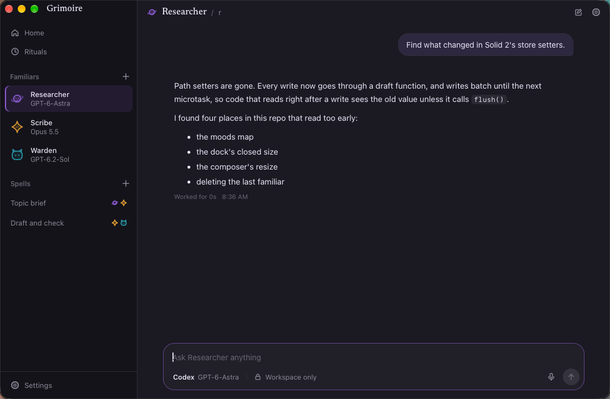
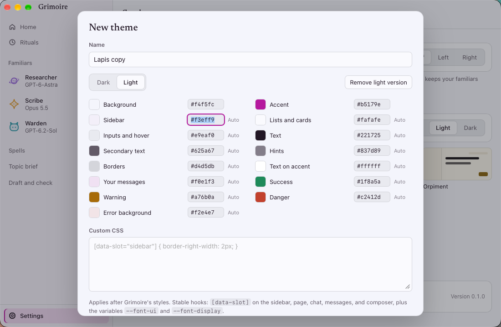
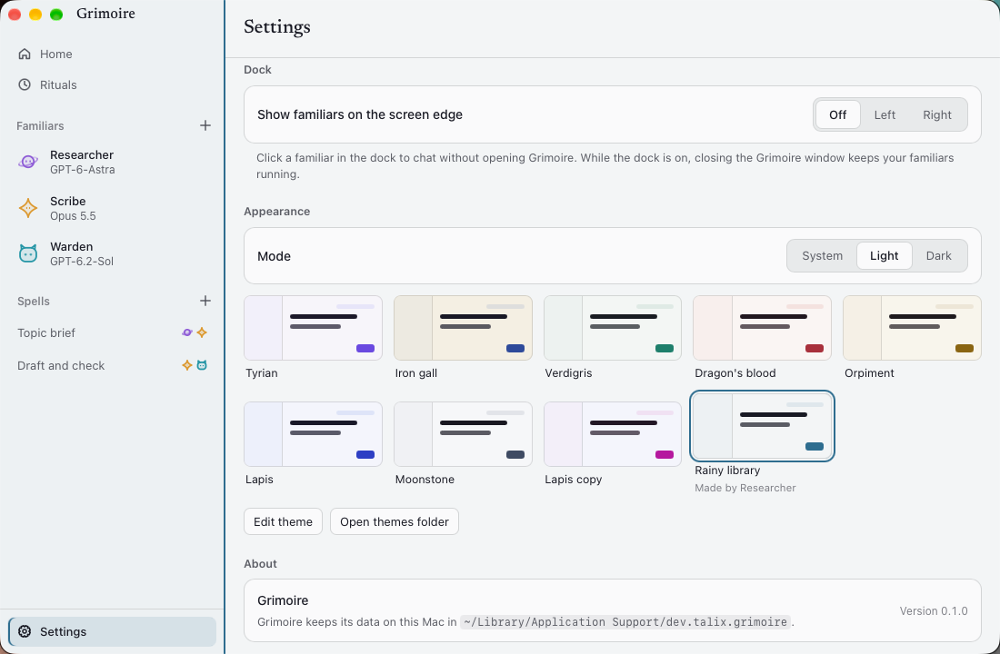
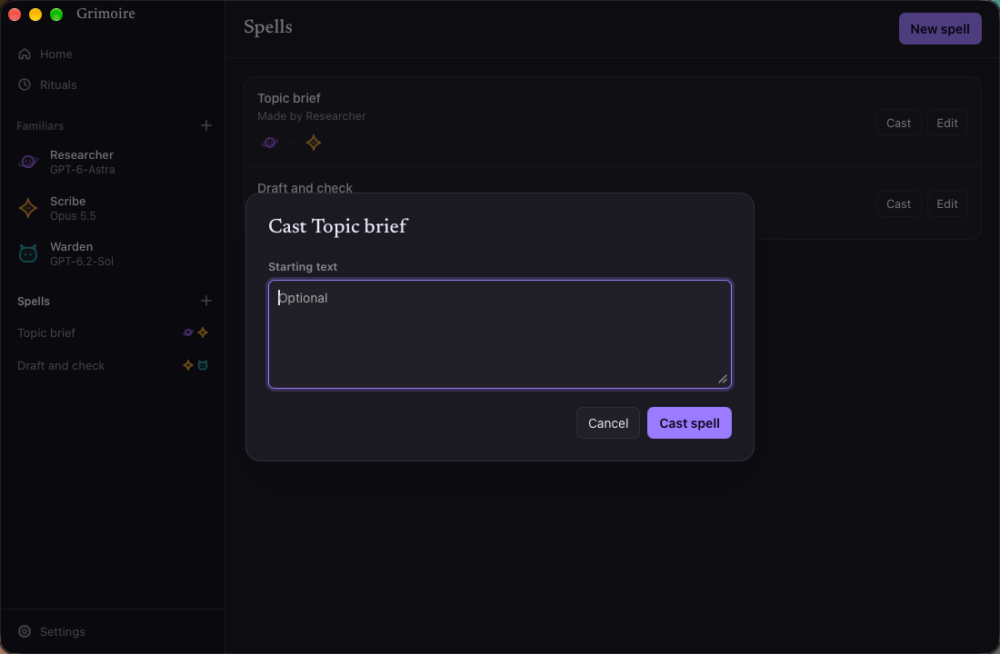

<p align="center">
  <picture>
    <source media="(prefers-color-scheme: dark)" srcset="src/assets/icon-night.svg">
    
  </picture>
</p>

<h1 align="center">Grimoire</h1>

<p align="center">
  Persistent AI familiars for your Mac. Each one has a name, a face, a workspace folder, and runs on Codex or Claude.
</p>

<p align="center">
  
</p>

## What it does

- **Familiars** keep their conversation across restarts. Each has an animated outline avatar that
  blinks, glances, and fidgets when idle, works while busy, smiles when it finishes, and frowns after
  an error.
- **Spells** chain familiars: research, then write, then review. Each step gets the last reply.
  Click a spell in the sidebar to cast it.
- **Memory** carries notes from one chat to the next, for each familiar and each coven.
- **Rituals** send a familiar the same message on a schedule, like a morning summary.
- **Covens** group familiars. Home's summoning circle shows everyone or one coven at a time, with
  lines for the spells between familiars and gold arcs for their rituals.
- **Themes** come as seven built-in inks, and you can edit or write your own as JSON.
- **Familiars make things too.** Ask one for "a spell that…" or "a theme that feels like a rainy
  library" and it saves it through Grimoire's own tools, credited to it.
- **The vault** keeps logins, API keys, and cards in your macOS Keychain. Familiars can use a
  secret in a command without ever seeing it, and Grimoire asks you first.
- **The dock** pins your familiars to the edge of the screen, so you can chat without opening
  the main window.
- **Voice** dictation in the composer uses macOS speech recognition.

<table>
  <tr>
    <td width="50%"></td>
    <td width="50%"></td>
  </tr>
  <tr>
    <td>Seven inks, each with a dark and a light version.</td>
    <td>Edit any color and watch the whole app change as you go.</td>
  </tr>
  <tr>
    <td width="50%"></td>
    <td width="50%"></td>
  </tr>
  <tr>
    <td>A theme a familiar made, with its own CSS.</td>
    <td>Casting a spell from the sidebar.</td>
  </tr>
</table>

## Run it

You need [Bun](https://bun.sh), Rust, and `codex` or `claude` installed and signed in. Grimoire reads
`PATH` from your login shell, so it finds them when you open it from Finder too.

```sh
bun install
bunx tauri dev                    # development
bunx tauri build --bundles app    # src-tauri/target/release/bundle/macos/Grimoire.app
```

Shortcuts: ⌘K opens the command palette, ⌘N summons a familiar, ⌘, opens Settings, and ⌘1 to ⌘9 open
a familiar.

## Familiars

Build a familiar's avatar in the avatar studio: one of six shapes (orbit, spark, cloud, drop, ears,
classic), three eye styles, and any color. Each shape has its own moves, like the orbit's moon or
the cloud's drizzle, and all motion stops when macOS Reduce Motion is on. The avatar's color tints
that familiar's chat.

The gear in the chat header changes a familiar's avatar, name, model, effort, or access, or deletes
it. The model chip in the composer shows the model it is running and switches it.

**Access.** "Workspace only" keeps Codex in its `workspace-write` sandbox and runs Claude in
`acceptEdits` mode, so it can edit files but shell commands are refused. "Full access" uses Codex
`danger-full-access` and Claude `bypassPermissions`. Neither asks for approval during a turn.

## Attachments

Drop files on the chat, paste a screenshot, or click the paperclip in the composer. You can attach up
to 10 files to a message, and each image can be up to 20 MB. The composer shows images as thumbnails
and other files as chips, each with a button to remove it.

- **Images** (PNG, JPEG, GIF, WebP) go to the model as images: Codex gets a `localImage` input, and
  Claude gets a base64 image block next to the text.
- **Other files** are copied into the familiar's workspace under `attachments/<message id>/`, and
  Grimoire adds their paths to the end of the message, so the familiar reads them with its own tools.
  "Workspace only" access covers this.

Grimoire keeps a copy of every attachment in `attachments/<message id>/` in its data folder. Sent
messages show their attachments, and clicking one opens it in its default app. A queued message keeps
its attachments until it runs. Deleting a familiar deletes its stored attachments, but not the
copies in its workspace.

## Chats and the palette

Each familiar keeps a list of chats. The chat header shows the current chat's title, which comes from
the first message you send in it. Click the title to filter past chats, open one, rename or delete it,
or start a new chat (the pencil button does that too). Opening an older chat picks its conversation
back up: your next message resumes that chat's Codex thread or Claude session. Deleting the open chat
switches to the newest one left. You can't switch chats while the familiar is replying. Rituals and
spells post into the familiar's current chat.

⌘K opens the command palette anywhere in the main window. Type part of a name to jump to a familiar,
cast a spell, open Home, Rituals, or a Settings section, or run an action: summon a familiar, start a
new spell, or start a new chat with the familiar you're in. From two letters on, it also searches the
text of every message you sent and every reply, and shows the familiar, the chat, and the matching
words. Picking a message opens its chat and scrolls to it. Arrow keys move, Enter opens, Esc closes.

## Covens and the circle

Home seats your familiars around a summoning circle. A curved line joins two familiars for each spell
that hands work between them (hover it for the name), a gold arc on the outer ring marks a familiar
with rituals, and a working familiar glows with a line from the center.

A coven is a named group of familiars, and each familiar sits in one at most. The chips above the
circle switch between everyone and one coven; "All" seats each coven together under a labeled arc.
Create a coven with the + chip, change its name and familiars with "Edit", or pick a familiar's coven
in its settings. The sidebar groups familiars by coven, with the rest under "Unbound", and
`list_familiars` tells familiars which coven each one is in.

## Memory

Each familiar keeps a markdown memory, and each coven has one its familiars share. A familiar reads
its own memory and its coven's at the start of every new chat (Claude through
`--append-system-prompt`, Codex through the thread's developer instructions). It adds a dated note
with `remember`, tidies with `rewrite_memory`, and checks the latest with `read_memory`; each takes
`scope: "coven"` for the shared one. An edit made mid-chat reaches the familiar in its next new chat.

The book button in the chat header opens a familiar's memory, and the coven editor on Home has the
coven's. Both show the size against the 16 KB limit and who last changed it. The files live in
`memory/` in the data folder: `<familiar id>.md` and `coven-<coven id>.md`. Deleting a familiar or
coven deletes its memory.

## Spells and rituals

A spell is a list of steps, each sent to one familiar, which waits for the reply before the next.
In a step, `{{input}}` is the text you cast it with and `{{previous}}` is the last reply; the last
reply is added at the end when a step doesn't use it.

A ritual sends a prompt every few hours, daily at a time, or on chosen weekdays. One timer sleeps
until the next run, and a run missed while Grimoire was closed fires once at the next launch.

## Familiars asking familiars

A familiar can ask another one for help with `ask_familiar`. Grimoire sends the message to the other
familiar's chat, labeled "Asked by Researcher", waits for its reply, and hands the reply back. The
asking familiar's chat shows a row like "Asked Scribe". If the other familiar is busy, the question
waits in its queue like any message.

Grimoire refuses a question when:

- a familiar asks itself;
- it would make a loop, like Scribe asking Researcher while Researcher waits on Scribe;
- it would be a fourth familiar in a row (A asks B, B asks C, C asks D is the limit);
- Settings, Permissions says no. "Who can ask whom" is any familiar (the default), only familiars in
  the same coven, or nobody.

A familiar waits up to 10 minutes for a reply, counted from when its question is queued. Turn on
"Approve each question" in the same section and Grimoire asks you first: "Researcher wants to ask
Scribe", with the message. No answer in 2 minutes counts as Deny.

Grimoire tells Codex (`tool_timeout_sec`) and Claude (the MCP server's `timeout`) to allow 15
minutes for its tool calls, since their defaults are shorter than a reply can take.

## Vault

Settings, Vault holds logins, API keys, and cards. Secret values go in your macOS Keychain under
`dev.talix.grimoire.vault`; Grimoire's database stores only the name, site, username, and a card's
last four digits.

Familiars can find items with `vault_search` (no secrets) and use one with `vault_use`:

1. Grimoire asks you in the corner of the window: "Researcher wants to use the password for
   github.com". Allow once, Always allow, or Deny. No answer in 2 minutes counts as Deny.
2. On yes, Grimoire puts the secret in a one-time named pipe and gives the familiar only its path.
   The familiar reads it inside the command that needs it, like `curl -H "Authorization: Bearer
   $(cat <path>)"`, so the value never enters the conversation sent to OpenAI or Anthropic.
3. The pipe gives out the secret once, then disappears. Unread, it expires after 2 minutes.

A familiar with shell access could still print what it reads, so Grimoire tells familiars never to,
and every request shows in the item's history. An item's page lists the familiars you've always
allowed, with a button to make them ask again.

## Permissions

Settings, Permissions decides when familiars need your OK before a shell command:

- **Never ask** (the default): familiars act on their own, within the access you gave each one.
- **Ask when a rule matches**: Grimoire asks when a command matches an "Always ask" rule. It starts
  with `git push*`, `rm -rf *`, and `sudo *`.
- **Ask before every command**: Grimoire asks unless an "Allow without asking" rule matches. An
  "Always ask" rule wins when both match.

In a rule, `*` matches anything. "Always allow" on a prompt adds an allow rule for that exact
command. Codex asks through its approval requests (Grimoire sets its approval policy to
`untrusted`, so commands it knows only read run without asking); Claude asks through a `PreToolUse`
hook on Bash that Grimoire registers, which runs even for commands your own Claude settings allow.

## Notifications and the menu bar

Grimoire sends a macOS notification when:

- a familiar finishes a turn ("Scribe finished", with the first line of the reply) or fails one,
- a familiar needs your OK ("Warden needs your OK", with the command or the vault item), with Allow
  and Deny buttons on the notification,
- a ritual runs ("Morning briefing ran"), or a spell ends ("Topic brief finished" or "Topic brief
  failed at step 2"). The steps inside a spell stay quiet.

Clicking a notification opens the main window on that familiar, where an approval card waits in the
corner. macOS asks for permission when the first notification is about to go out. Settings,
Notifications turns each kind off, and "Only while Grimoire is in the background" (on by default)
keeps them quiet while the main window is in front.

The menu bar shows Grimoire's seal with the number of familiars working beside it. Its menu lists
each familiar as Working, New reply, or Idle (click one to open its chat), then Open Grimoire and
Quit Grimoire. Settings, General hides it.

Notifications use `UNUserNotificationCenter`, which works only from a bundled `Grimoire.app`; under
`bunx tauri dev` they're off. The menu bar icon is drawn in `scripts/icons.mjs` as
`src/assets/tray.svg`; render it with `bunx @resvg/resvg-js-cli --fit-width 18` (and 36 for
`tray@2x.png`) into `src-tauri/icons/tray.png`.

## Usage

Settings, Usage shows your plan limits and what Grimoire itself used:

- **Codex**: the 5-hour and weekly limits from `account/rateLimits/read`. Opening the page starts
  `codex app-server` if it isn't running; it stops again after 10 idle minutes.
- **Claude**: Claude only reports limits while it replies (`rate_limit_event`), so the page shows the
  latest snapshot and how old it is.
- **Grimoire, last 7 days**: tokens per turn, input and output together, by source (you, rituals,
  spells) or by familiar, with a daily chart and a table of the numbers.

## Updates

Settings, Updates checks this repository's GitHub releases (the latest release's tag against the
app's version), once a day at launch unless you turn that off, or whenever you click "Check for
updates". A newer version shows in the sidebar and as a Download button that opens the release.
Installing it is a download for now; automatic installs need signed release builds.

## Themes

Pick a theme in Settings. The seven built-ins are named for old inks and pigments: Tyrian (the
default), Iron gall, Verdigris, Dragon's blood, Orpiment, Lapis, and Moonstone. Mode (system, light,
or dark) is a separate setting.

Your own themes are JSON files in `~/Library/Application Support/dev.talix.grimoire/themes`.
Settings opens the folder, and Grimoire reloads it whenever its window comes back to the front, so
any text editor works. "Make a copy to edit" opens the same file in the built-in editor.

```json
{
  "version": 1,
  "name": "Rainy library",
  "colors": { "accent": "#8fb3c9" },
  "variants": {
    "dark": { "canvas": "#14181c" },
    "light": { "canvas": "#f3f5f6", "accent": "#2f6d8f" }
  },
  "css": "[data-slot=\"sidebar\"] { border-right: 2px solid var(--accent); }"
}
```

- `colors` applies to both appearances, and `variants.dark` or `variants.light` override it. Each
  appearance needs `canvas` (the background) and `accent`; Grimoire derives the rest. A theme with
  only one appearance always shows in it.
- Optional roles: `sidebar`, `surface`, `raised`, `text`, `textMuted`, `textFaint`, `border`,
  `accentForeground`, `userBubble`, `success`, `warning`, `danger`, and `dangerSurface`, all in hex.
- `css` runs after Grimoire's own styles. Target the stable hooks, not class names: `[data-slot]` is
  set on `sidebar`, `sidebar-row`, `page`, `chat`, `chat-header`, `message` (with `data-role` of
  `user`, `assistant`, or `tools`), `composer`, and `dock`. `--font-ui` and `--font-display` set the
  two typefaces. Remote files don't load, because the app's content security policy blocks them.
- A file that fails to load shows its error under the theme list.

## App icons

Grimoire has two icons, a red wax seal on paper and the same seal on dark ink. Settings switches
between them or matches the app's appearance. The Dock shows your choice while Grimoire is open;
Finder and a closed Dock icon show the paper one, which is the bundle icon.

The icons are drawn in `scripts/icons.mjs`. To change them:

```sh
bun scripts/icons.mjs     # writes src/assets/icon-paper.svg and icon-night.svg
bunx @resvg/resvg-js-cli --fit-width 1024 src/assets/icon-paper.svg app-icon.png
bunx @resvg/resvg-js-cli --fit-width 512 src/assets/icon-paper.svg src-tauri/icons/app-paper.png
bunx @resvg/resvg-js-cli --fit-width 512 src/assets/icon-night.svg src-tauri/icons/app-night.png
bunx tauri icon app-icon.png    # then delete the android and ios folders it adds
```

## How it works

<details>
<summary>Processes, sessions, storage, and the familiar tools</summary>

- **Processes.** Nothing starts at launch. Codex familiars share one `codex app-server` process
  (JSON-RPC over stdio), started on the first Codex message and stopped after 10 idle minutes. Each
  Claude familiar gets one `claude -p --input-format stream-json` process, started on its first
  message and stopped after 5 idle minutes. Closing Grimoire stops them all.
- **Sessions.** Each chat saves its Codex thread ID or Claude session ID, so a restart resumes the
  same conversation. "New chat" starts a chat with no session; opening an older chat loads its
  session for the next turn. The current chat's session is also kept on the familiar, which is what
  the providers resume.
- **Search.** Messages are indexed in an SQLite FTS5 table that triggers keep in sync as messages are
  added, streamed, and deleted. Tool and error rows aren't indexed.
- **Streaming.** Text goes to the window at most every 50 ms and to SQLite every 750 ms and at the
  end of each turn. Markdown renders once a message is finished.
- **Queue.** A message sent while a familiar works waits and runs next. Stop interrupts the turn
  (Claude through its interrupt request, Codex through `turn/interrupt`) and cancels the queue.
- **Familiar tools.** Grimoire gives each familiar an MCP server named `grimoire` (`--mcp-config`
  for Claude, thread config for Codex) with `list_familiars`, `list_spells`, `create_spell`,
  `list_themes`, `create_theme`, `set_theme`, `vault_search`, `vault_use`, `ask_familiar`,
  `read_memory`, `remember`, and `rewrite_memory`. The CLI starts `grimoire mcp <socket> <agent-id>`,
  which relays calls to the app over `grimoire.sock` in its data folder (owner-only). Familiars can't
  cast, edit, or delete spells.
- **Claude billing.** With "Claude subscription" (the default), Grimoire removes
  `ANTHROPIC_API_KEY`, `ANTHROPIC_AUTH_TOKEN`, and `ANTHROPIC_BASE_URL` from the `claude` process
  so it uses your claude.ai Pro or Max sign-in. "API key" leaves them in place.
- **Storage.** `~/Library/Application Support/dev.talix.grimoire/grimoire.db`, with your themes in
  `themes/`, memories in `memory/`, and attachments in `attachments/` beside it. Default workspaces go under `~/Grimoire`. Deleting a familiar keeps its
  workspace folder.
- **Names.** The code calls a familiar an agent, a spell a workflow, and a ritual a routine.

</details>

## Checks

```sh
bun run test                     # timeline, models, chat store, palette ranking, moods, themes
cd src-tauri
cargo test                       # unit tests
cargo test -- --ignored          # live turns against the real codex and claude CLIs (costs tokens)
cargo clippy --all-targets -- -D warnings
```

## License

[MIT](LICENSE)
