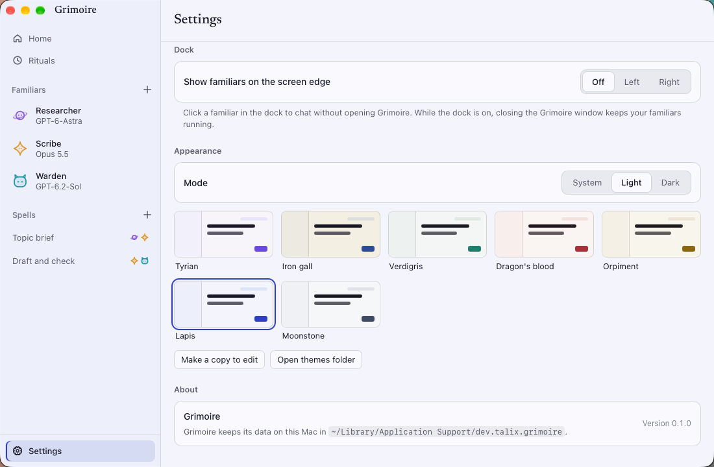
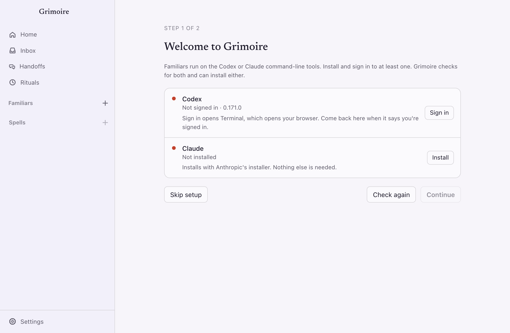
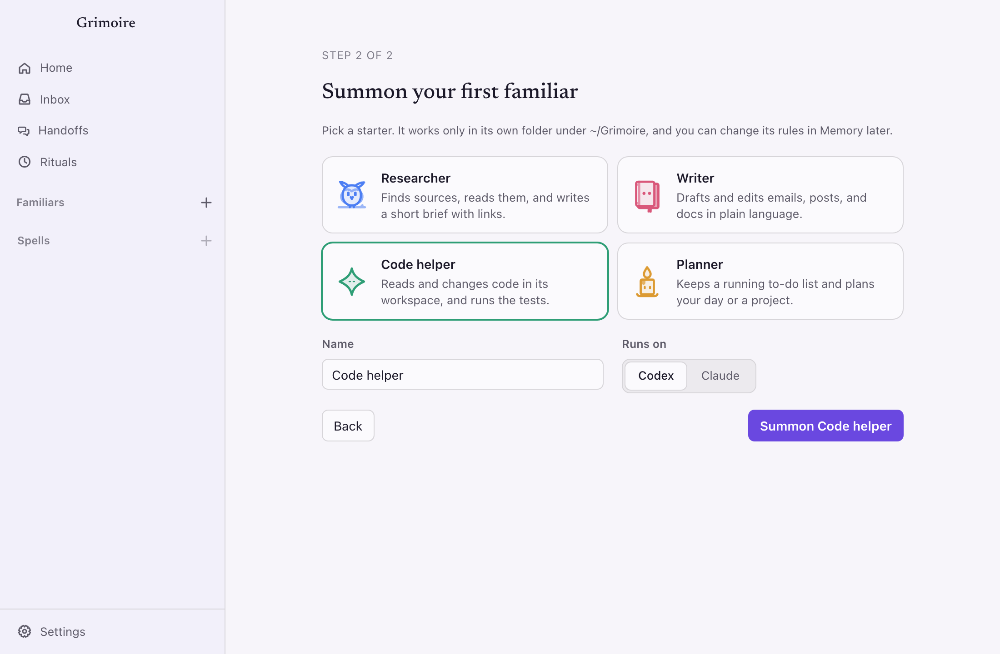
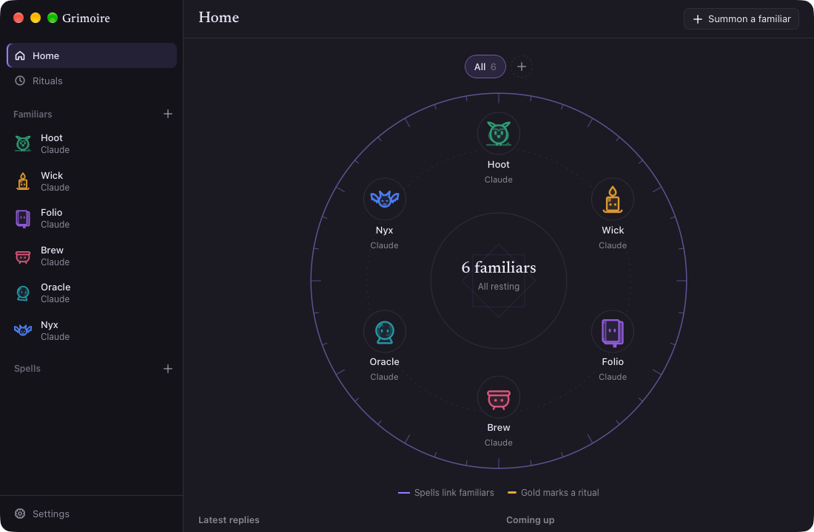

<p align="center">
  <picture>
    <source media="(prefers-color-scheme: dark)" srcset="src/assets/icon-night.svg">
    
  </picture>
</p>

<h1 align="center">Grimoire</h1>

<p align="center">
  Persistent AI familiars for your Mac. Each one has a name, a face, a workspace folder, and runs on Codex or Claude.
</p>

<p align="center">
  
</p>

## What it does

- **Familiars** keep their conversation across restarts. Each has an animated outline avatar that
  blinks, glances, and fidgets when idle, works while busy, smiles when it finishes, and frowns after
  an error.
- **Spells** chain familiars: research, then write, then review. Each step gets the last reply.
  Steps can run together, and a check can send work back, like an editor returning a draft. Click a
  spell in the sidebar to cast it, and open any past cast to see each step.
- **The inbox** gathers every familiar's open questions and approvals in one list. A familiar asks
  with a few short options and the one it recommends, then keeps working; your tap goes back to it
  as a new message.
- **Memory** carries rules, facts, and project notes from one chat to the next, for each familiar and each coven.
- **Ledgers** keep each familiar's goal, status, and what it's waiting on. A familiar gets its ledger
  when a chat starts and updates it with `update_ledger`; you edit it in the strip under the chat bar.
- **Rituals** send a familiar the same message, or cast a spell, on a schedule, like a morning summary.
  A ritual can also run when something happens: a pull request opens in a GitHub repo (through `gh`),
  a file or folder in your home folder changes, new mail reaches the Mail app's inbox, or something
  POSTs to the ritual's private webhook on `127.0.0.1:47615`. The message says what set it off.
  Saving or restarting never runs one, and each runs at most once a minute.
- **Covens** group familiars. Home's summoning circle shows everyone or one coven at a time, with
  lines for the spells between familiars and gold arcs for their rituals.
- **Themes** come as seven built-in inks, and you can edit or write your own as JSON.
- **Familiars make things too.** Ask one for "a spell that…" or "a theme that feels like a rainy
  library" and it saves it through Grimoire's own tools, credited to it.
- **The vault** keeps logins, API keys, and cards in your macOS Keychain. Familiars can use a
  secret in a command without ever seeing it, and Grimoire asks you first.
- **Drafts, not sends.** A familiar never sends email, Slack messages, or posts. It drafts them with
  `draft_message`, and the draft shows up as a card in the corner, with a notification when approval
  notifications are on. Edit it, open it in Mail or copy it, then mark it sent or discard it; the
  familiar hears which, with your edits. "Drafts" in the corner lists recent ones.
- **The dock** pins your familiars to the edge of the screen, so you can chat without opening
  the main window. Pick which familiars it shows in Settings, General; new ones show up until you
  turn them off.
- **Quick Ask** opens a small panel from any app with ⇧⌘Space. Pick a familiar, ask it something,
  watch the reply stream in, or answer what's waiting in the inbox. Change or turn off the shortcut in
  Settings, General. It needs no Accessibility or Input Monitoring permission.
- **Helpers** take long jobs. A familiar calls `start_helper` and keeps chatting while a helper works
  in a hidden chat, on a fresh session with the familiar's model, workspace, and access. The result
  comes back as a message labeled "Helper <label>", which starts the familiar's next turn. Up to 3 run
  at once, each for at most 30 minutes, and a helper can't start helpers or message other familiars.
  The helpers button in the chat header shows each one's status, time, and transcript, with a Stop
  button. Helpers still running when Grimoire quits show as interrupted at the next launch.
- **Voice** dictation in the composer uses macOS speech recognition.
- **Remote familiars** run on another Mac over SSH, so the menu bar app on your laptop can drive a
  Mac Studio at home.

<table>
  <tr>
    <td width="50%"></td>
    <td width="50%"></td>
  </tr>
  <tr>
    <td>Seven inks, each with a dark and a light version.</td>
    <td>Edit any color and watch the whole app change as you go.</td>
  </tr>
  <tr>
    <td width="50%"></td>
    <td width="50%"></td>
  </tr>
  <tr>
    <td>A theme a familiar made, with its own CSS.</td>
    <td>Casting a spell from the sidebar.</td>
  </tr>
</table>

## Install

Download the `.dmg` from the [latest release](https://github.com/dev-talix/grimoire/releases/latest),
open it, and drag Grimoire to Applications. The app is signed and notarized, so it opens without a
warning. You don't need Bun or Rust.

On first launch, a setup wizard checks for the Codex and Claude command-line tools. It can install
either one: Claude with Anthropic's installer, and Codex with Homebrew, or npm when Homebrew isn't
there. "Sign in" opens Terminal to run `codex login` or `claude auth login`. Once one of them is
signed in, pick a starter familiar (Researcher, Writer, Code helper, or Planner) and Grimoire
summons it with workspace-only access. "Skip setup" goes straight to the summon form.

<table>
  <tr>
    <td width="50%"></td>
    <td width="50%"></td>
  </tr>
</table>

Grimoire checks for a new version once a day. Release builds download it, check its signature
against the key built into the app, and install it; the sidebar then offers "Restart to use" the new
version. Turn this off in Settings, Updates.

## Build from source

You need [Bun](https://bun.sh), Rust, and `codex` or `claude` installed and signed in. Grimoire reads
`PATH` from your login shell, so it finds them when you open it from Finder too.

```sh
bun install
bunx tauri dev                    # development
bunx tauri build --bundles app    # src-tauri/target/release/bundle/macos/Grimoire.app
```

`tauri build` signs the app with the Developer ID certificate named in `src-tauri/tauri.conf.json`,
which has to be in your keychain. Local builds have no updater key, so their Updates page opens the
release page instead of installing. To notarize a build for other Macs by hand, save an App Store
Connect API key once as a keychain profile, then submit and staple:

```sh
xcrun notarytool store-credentials grimoire-notary --key AuthKey_<id>.p8 --key-id <id> --issuer <issuer-id>

cd src-tauri/target/release/bundle/macos
ditto -c -k --keepParent Grimoire.app /tmp/Grimoire.zip
xcrun notarytool submit /tmp/Grimoire.zip --keychain-profile grimoire-notary --wait
xcrun stapler staple Grimoire.app
```

### Releasing

Bump the version in `package.json`, `src-tauri/Cargo.toml`, and `src-tauri/tauri.conf.json`, merge,
then push a tag such as `v0.5.0`. The Release workflow (`.github/workflows/release.yml`) builds a
universal app, signs and notarizes it, signs the update, and saves a draft release with the `.dmg`,
the update archive, and `latest.json`. Publish the draft to ship it: installed copies only see
published releases.

The workflow needs these repository secrets:

| Secret | What it holds |
|---|---|
| `APPLE_CERTIFICATE` | The Developer ID Application certificate and private key, exported as `.p12` and base64-encoded |
| `APPLE_CERTIFICATE_PASSWORD` | The password set when exporting the `.p12` |
| `APPLE_SIGNING_IDENTITY` | The certificate's name, like `Developer ID Application: Name (TEAMID)` |
| `APPLE_API_ISSUER` | The App Store Connect API issuer ID, for notarization |
| `APPLE_API_KEY` | The App Store Connect API key ID |
| `APPLE_API_PRIVATE_KEY` | The contents of that key's `AuthKey_<id>.p8` file |
| `TAURI_SIGNING_PRIVATE_KEY` | The updater private key from `bunx tauri signer generate` |
| `TAURI_SIGNING_PRIVATE_KEY_PASSWORD` | Its password, if it has one |

It also needs the repository variable `TAURI_UPDATER_PUBKEY`, the public key that `tauri signer
generate` prints. It isn't secret. Keep the private key safe: losing it means installed copies can't
update to builds signed with a new one.

Shortcuts: ⌘K opens the command palette, ⌘N summons a familiar, ⌘, opens Settings, and ⌘1 to ⌘9 open
a familiar.

## Familiars

Build a familiar's avatar in the avatar studio: one of twelve shapes (orbit, spark, cloud, drop,
ears, classic, owl, candle, tome, cauldron, crystal ball, bat), three eye styles, and any color. Each
shape has its own moves, like the orbit's moon, the candle's flame, or the cauldron's bubbles, and
all motion stops when macOS Reduce Motion is on. The avatar's color tints
that familiar's chat.

<p align="center">
  
</p>

The owl, candle, tome, cauldron, crystal ball, and bat [in every mood](docs/screenshots/familiar-states.gif).

The gear in the chat header changes a familiar's avatar, name, model, effort, or access, or deletes
it. The model chip in the composer shows the model it is running and switches it.

**Access.** "Workspace only" keeps Codex in its `workspace-write` sandbox and runs Claude in
`acceptEdits` mode, so it can edit files but shell commands are refused. "Full access" uses Codex
`danger-full-access` and Claude `bypassPermissions`. Neither asks for approval during a turn.

### Familiars on another Mac

Pick "Another Mac over SSH" under "Runs on" when you summon a familiar, and enter an SSH destination
like `me@studio.local` or a `Host` alias from `~/.ssh/config`. Grimoire runs the CLI there with the
system `ssh` and talks to it over the same stdio stream it uses locally. Set up the other Mac first:

1. Turn on Remote Login in System Settings, General, Sharing.
2. Make `ssh <destination>` work from Terminal with a key, without a password prompt. Grimoire runs
   ssh with `BatchMode=yes`, so it can't answer prompts. Connect once in Terminal to accept the
   host key.
3. Install Codex or Claude on that Mac and sign in there. Grimoire runs it from a login shell
   (`$SHELL -lc`), so PATH includes what your `.zprofile` or `.profile` adds. When the CLI isn't
   there, as with one installed through nvm, Grimoire also takes PATH from an interactive shell
   (`.zshrc`).

"Check connection" in the form shows whether the Mac answers and where `codex` and `claude` are on
it. The workspace is a path on that Mac, a full path or one under `~/`, and defaults to a new folder
in `~/Grimoire` there. Grimoire creates it when you summon the familiar.

If the Mac doesn't answer when you summon the familiar, Grimoire still saves it, and its host badge
says "Setup pending". Grimoire finishes the setup the next time that Mac answers: before the
familiar's next turn, in a background retry every three minutes, or when you press "Check
connection" in its settings. Other errors, like a workspace path the Mac refuses, still stop the
summon. When a chat turn, ritual, spell step, or side conversation can't reach the Mac, the chat
shows a plain "that Mac is offline" message instead of the ssh error, and the badge says "Offline"
until a later try gets through. A key ssh refuses or a changed host key still shows ssh's own
message, since you have to fix those yourself.

What doesn't cross machines yet: Grimoire's tools (saving memory, making spells and themes, the
vault, and asking other familiars) need a socket on this Mac, so remote familiars run without them.
They still get their memory when a chat starts, and other familiars can still ask them. Attachments
are refused, and Finder can't open the workspace. The host can't be changed after you summon the
familiar. Your Permissions rules still apply, since Codex and Claude ask Grimoire over the same
stream.

### Linked Macs

Two Macs running Grimoire on the same Tailscale tailnet can link, with no SSH. Each familiar lives
on one Mac, its home, which keeps its chats, memory, ledger, and rituals. Every linked Mac lists it
with its home Mac's name, shows its chat as it streams, and can send it messages and stop its turns.
Only the home Mac can edit or delete it. A linked Mac can also summon a new familiar on another
Mac, which then becomes its home.

To link, make a pairing code on one Mac, then enter that Mac's Tailscale name or address and the
code on the other. A code is 8 characters, works once, lasts 10 minutes, and dies after 5 wrong
tries. Unlinking on either Mac removes the link from both, or from the other one the next time it
connects.

Grimoire asks the Tailscale CLI (`tailscale status --json`) for this Mac's addresses and its peers,
listens on port 47620 on those addresses only, and drops connections from any address Tailscale
doesn't list as a peer. It also sends a token or pairing code only to an address Tailscale lists.
It checks again every minute and moves to new addresses when they change. Without the CLI, it falls
back to tailnet-range addresses (100.64.0.0/10 and fd7a:115c:a1e0::/48) on Tailscale's own tunnel
interfaces, never Wi-Fi or Ethernet, since ISPs and hotspots use 100.64.0.0/10 too. Tailscale
encrypts the traffic. Each pair of Macs shares a token each way, kept in the Keychain. A linked Mac
can only list familiars, read and send chat messages, stop turns, and summon familiars that run on
the home Mac itself with workspace access. It can't reach the vault, approvals, settings, memory, or
Grimoire's tools. Attachments don't cross yet. When a linked Mac is offline, its familiars stay
listed as of the last time it answered. When it reconnects, it catches up on what it missed, or
reloads open chats if it missed too much or the other Mac restarted. Switching chats on the home Mac
reloads that familiar's chat on linked Macs.

Familiars can ask and message familiars on a linked Mac too (see below). The asking Mac runs its own
checks and approval prompt, then the home Mac runs the side conversation and sends the reply back to
that Mac only. A familiar asking from another Mac gets no tools, vault, or settings on the home Mac.

## Attachments

Drop files on the chat, paste a screenshot, or click the paperclip in the composer. You can attach up
to 10 files to a message, and each file can be up to 20 MB. The composer shows images as thumbnails
and other files as chips, each with a button to remove it.

- **Images** (PNG, JPEG, GIF, WebP) go to the model as images: Codex gets a `localImage` input, and
  Claude gets a base64 image block next to the text.
- **Other files** are copied into the familiar's workspace under `attachments/<message id>/`, and
  Grimoire adds their paths to the end of the message, so the familiar reads them with its own tools.
  "Workspace only" access covers this.

Grimoire keeps a copy of every attachment in `attachments/<message id>/` in its data folder. Sent
messages show their attachments, and clicking one opens it in its default app. A queued message keeps
its attachments until it runs. Deleting a familiar deletes its stored attachments, but not the
copies in its workspace.

## Chats and the palette

Each familiar keeps a list of chats. The chat header shows the current chat's title, which comes from
the first message you send in it. Click the title to filter past chats, open one, rename or delete it,
or start a new chat (the pencil button does that too). Opening an older chat picks its conversation
back up: your next message resumes that chat's Codex thread or Claude session. Deleting the open chat
switches to the newest one left. You can't switch chats while the familiar is replying. Rituals and
spells post into the familiar's current chat.

⌘K opens the command palette anywhere in the main window. Type part of a name to jump to a familiar,
cast a spell, open Home, Rituals, or a Settings section, or run an action: summon a familiar, start a
new spell, or start a new chat with the familiar you're in. From two letters on, it also searches the
text of every message you sent and every reply, and shows the familiar, the chat, and the matching
words. Picking a message opens its chat and scrolls to it. Arrow keys move, Enter opens, Esc closes.

## Covens and the circle

Home seats your familiars around a summoning circle. A curved line joins two familiars for each spell
that hands work between them (hover it for the name), a gold arc on the outer ring marks a familiar
with rituals, and a working familiar glows with a line from the center.

A coven is a named group of familiars, and each familiar sits in one at most. The chips above the
circle switch between everyone and one coven; "All" seats each coven together under a labeled arc.
Create a coven with the + chip, change its name and familiars with "Edit", or pick a familiar's coven
in its settings. The sidebar groups familiars by coven, with the rest under "Unbound", and
`list_familiars` tells familiars which coven each one is in.

## Memory

Each familiar keeps a memory, and each coven has one its familiars share. A memory is a list of
entries, each a rule (a standing instruction), a fact (lasting, about you or your world), or a
project note (tied to a named project). Each entry holds up to 1,000 characters and records the day
Grimoire saved it and who saved it. A familiar reads its own memory and its coven's at the start of
every new chat (Claude through `--append-system-prompt`, Codex through the thread's developer
instructions): rules first, as instructions to follow, then facts, then project notes grouped by
project, each with its date. An edit made mid-chat reaches the familiar in its next new chat.

A familiar saves an entry with `remember` (`kind` fact, rule, or project, plus `project` for a
project note), lists entries and their ids with `read_memory`, and deletes one with
`forget_memory`. `remember` and `read_memory` take `scope: "coven"` for the shared memory, and
`forget_memory` finds the id in either. Familiars are told to save a correction, or how you want
something done from now on, as a rule in your words. `rewrite_memory` is gone; a chat that calls it
gets told to use the other three.

Hover a message you sent and click the book button to make it a rule for that familiar. The book
button in the chat header opens a familiar's memory, and the coven editor on Home has the coven's.
Both list Rules, Facts, and Projects, where you can add, edit, delete, and change the kind of any
entry, with the 16 KB limit and who last changed it. The files live in `memory/` in the data folder:
`<familiar id>.json` and `coven-<coven id>.json`. A markdown memory from before entries
(`<id>.md`) reads as facts, one per line or list item, and becomes a `.json` file the first time it
changes, with the old file kept as `.md.bak`. Backups carry memory, and importing an older backup
turns its markdown memory into facts. Deleting a familiar or coven deletes its memory.

## Spells and rituals

A spell is a list of steps, each sent to one familiar, which waits for the reply before the next.
In a step, `{{input}}` is the text you cast it with and `{{previous}}` is the last reply; the last
reply is added at the end when a step doesn't use it.

- **Steps that run together.** Tick "With step N" and a step starts at the same time as the one
  above it. The next step waits for all of them and gets every reply, each under its familiar's name.
- **Checks.** The loop button adds a check: if the reply contains, or doesn't contain, a phrase
  (case doesn't matter), the spell goes to the step you pick, like "doesn't contain APPROVED, go to
  step 2" to send a draft back to the writer. Otherwise it carries on. Each check sends the spell
  somewhere at most 3 times; a 4th match stops the cast with a message saying so.
- **History.** Every cast is saved with its starting text, start and end, and each step's familiar,
  the prompt as sent, and the reply. Each spell lists its last 5 casts. Click one to see every step,
  live while it runs, and "Cast again" with the same starting text. A cast cut short by quitting
  Grimoire shows as stopped.

On the Spells page, steps that run together share an outline and a loop mark shows each check. On
Home, those steps link to the steps before and after them, and a check that sends work to a familiar
not already linked shows as a dashed line.

A ritual runs every few hours, daily at a time, or on chosen weekdays. It either sends a familiar a
message or casts a spell, with optional starting text. A ritual that casts a spell skips a run while
that spell is still going, and deleting the spell deletes its rituals. One timer sleeps until the
next run, and a run missed while Grimoire was closed fires once at the next launch.

`create_spell` takes the same options: `parallel: true` on a step, and
`check: { when: "contains" | "lacks", phrase, goToStep }` with steps counted from 1.

## Familiars asking familiars

Familiars can talk to each other behind the scenes, out of both main chats:

- `ask_familiar` asks another familiar something and waits up to 10 minutes for the reply.
- `message_familiar` sends a message and carries on. When the other familiar is done, its reply
  arrives in the sender's chat as a new message labeled "Reply from Scribe", which starts the
  sender's next turn.

Each exchange runs in a side conversation: a hidden chat of the familiar being asked, with its own
CLI session. That session starts as a copy of the familiar's current chat (Claude's
`--fork-session`, Codex's `thread/fork`), so it answers from what it knows, and its main chat stays
as it was. It runs alongside whatever the familiar is doing for you. A familiar can follow up in the
same conversation by passing its id as `thread`.

The asking familiar's chat shows a row like "Asked Scribe" or "Messaged Scribe". Click it to read
the conversation in place, live while the other familiar works. Side conversations stay out of the
chat list, search, and backups.

Handoffs in the sidebar lists the latest 100 of these exchanges, newest first: who handed what to
whom, when, whether it's Waiting, Accepted, Done, or Failed, and a link that opens each thread.

`list_familiars` also lists the familiars on linked Macs, online or not. A familiar picks one by id,
by name when it's unique, or as "Scribe on NigelBot". The same limits apply across Macs, and the side
conversation lives on the familiar's home Mac, so the asking Mac's chat and Handoffs page name it
without opening it. If that Mac is offline, the request fails at once.

Grimoire refuses a question or message when:

- a familiar asks itself;
- it would make a loop, like Scribe asking Researcher while Researcher waits on Scribe;
- it would be a fourth familiar in a row (A asks B, B asks C, C asks D is the limit);
- a familiar has already sent 5 messages with `message_familiar` in the last 10 minutes;
- Settings, Permissions says no. "Who can ask whom" is any familiar (the default), only familiars in
  the same coven, or nobody.

Turn on "Approve each question" in the same section and Grimoire asks you first: "Researcher wants to
ask Scribe" (or "wants to message"), with the message. No answer in 2 minutes counts as Deny.

Grimoire tells Codex (`tool_timeout_sec`) and Claude (the MCP server's `timeout`) to allow 15
minutes for its tool calls, since their defaults are shorter than a reply can take.

## Vault

Settings, Vault holds logins, API keys, and cards. Secret values go in your macOS Keychain under
`dev.talix.grimoire.vault`; Grimoire's database stores only the name, site, username, and a card's
last four digits.

Familiars can find items with `vault_search` (no secrets) and use one with `vault_use`:

1. Grimoire asks you in the corner of the window: "Researcher wants to use the password for
   github.com". Allow once, Always allow, or Deny. No answer in 2 minutes counts as Deny.
2. On yes, Grimoire puts the secret in a one-time named pipe and gives the familiar only its path.
   The familiar reads it inside the command that needs it, like `curl -H "Authorization: Bearer
   $(cat <path>)"`, so the value never enters the conversation sent to OpenAI or Anthropic.
3. The pipe gives out the secret once, then disappears. Unread, it expires after 2 minutes.

A familiar with shell access could still print what it reads, so Grimoire tells familiars never to,
and every request shows in the item's history. An item's page lists the familiars you've always
allowed, with a button to make them ask again.

## Permissions

Settings, Permissions decides when familiars need your OK before a shell command:

- **Never ask** (the default): familiars act on their own, within the access you gave each one.
- **Ask when a rule matches**: Grimoire asks when a command matches an "Always ask" rule. It starts
  with `git push*`, `rm -rf *`, and `sudo *`, plus rules that catch a familiar sending messages
  itself (`*sendmail *`, `*osascript*Mail*`, `*hooks.slack.com*`, `*gh * comment*`).
- **Ask before every command**: Grimoire asks unless an "Allow without asking" rule matches. An
  "Always ask" rule wins when both match.

In a rule, `*` matches anything. "Always allow" on a prompt adds an allow rule for that exact
command. Codex asks through its approval requests (Grimoire sets its approval policy to
`untrusted`, so commands it knows only read run without asking); Claude asks through a `PreToolUse`
hook on Bash that Grimoire registers, which runs even for commands your own Claude settings allow.

## Notifications and the menu bar

Grimoire sends a macOS notification when:

- a familiar finishes a turn ("Scribe finished", with the first line of the reply) or fails one,
- a familiar needs your OK ("Warden needs your OK", with the command or the vault item), with Allow
  and Deny buttons on the notification,
- a ritual runs ("Morning briefing ran"), or a spell ends ("Topic brief finished" or "Topic brief
  failed at step 2"). The steps inside a spell stay quiet.

Clicking a notification opens the main window on that familiar, where an approval card waits in the
corner. macOS asks for permission when the first notification is about to go out. Settings,
Notifications turns each kind off, and "Only while Grimoire is in the background" (on by default)
keeps them quiet while the main window is in front.

The menu bar shows Grimoire's seal with the number of familiars working beside it. Its menu lists
each familiar as Working, New reply, or Idle (click one to open its chat), then Open Grimoire and
Quit Grimoire. Settings, General hides it.

Notifications use `UNUserNotificationCenter`, which works only from a bundled `Grimoire.app`; under
`bunx tauri dev` they're off. The menu bar icon is drawn in `scripts/icons.mjs` as
`src/assets/tray.svg`; render it with `bunx @resvg/resvg-js-cli --fit-width 18` (and 36 for
`tray@2x.png`) into `src-tauri/icons/tray.png`.

## Usage

Settings, Usage shows your plan limits and what Grimoire itself used:

- **Codex**: the 5-hour and weekly limits from `account/rateLimits/read`. Opening the page starts
  `codex app-server` if it isn't running; it stops again after 10 idle minutes.
- **Claude**: Claude only reports limits while it replies (`rate_limit_event`), so the page shows the
  latest snapshot and how old it is.
- **Grimoire, last 7 days**: tokens per turn, input and output together, by source (you, rituals,
  spells) or by familiar, with a daily chart and a table of the numbers.

## Budgets

A familiar's settings can cap its tokens per day or per week, counted from the usage Grimoire records
for each turn. A day starts at local midnight and a week on Monday. Once a familiar has used its
budget, Grimoire refuses new turns with a message saying how much it used and when it starts again.
Its rituals skip and log why, and a spell stops at its step with the same error. Usage, By familiar,
shows each budget as a bar under the familiar.

The plan limit guard ("Pause rituals when a plan limit passes 90%", on by default) sits under the
plan limits in Usage. Before a ritual runs, Grimoire checks the familiar's provider: a fresh Codex
reading for Codex familiars, and Claude's latest snapshot for Claude familiars. When a window that
hasn't reset is past the percentage, the ritual skips. Home and Rituals show a short notice, and the
ritual's row says why it skipped. Your own messages, "Run now", and spells still run.

## Export and import

Export a familiar from its settings, a spell from its editor, a coven from "Edit", or one of your
themes from the theme editor. Each becomes one JSON file, like `Researcher.grimoire.json`, with a
`kind` and a `version`:

- A familiar carries its name, provider, model, effort, access, avatar, and budget, and the SSH
  destination of a familiar on another Mac. Never its workspace folder, session, or chat.
- A spell names the familiar for each step, so it works on another Mac with familiars of those names.
- A coven carries its members' names. A theme is the same JSON as a file in the themes folder.

Settings, General, "Export a backup" saves familiars and covens with their memory, spells, rituals, your themes, and
settings (Claude billing, the dock, permission rules, and the plan limit guard) in one file. Chat
history goes in only when you tick "Include chat history". Vault items, Keychain secrets, and vault
grants never do.

"Import" takes a backup or any shared file and shows what it adds first. Everything gets a new id.
A name you already have gets " (2)". Spell steps, rituals, and coven members point at the familiars
the file brings, or else at yours with the same name; anything that can't be placed is listed and left
out. Imported familiars get new workspace folders under `~/Grimoire`, and the rows go in one
transaction. A familiar the file gives full access comes in with workspace access, unless you turn on
"Keep full access" in the preview.

### Grok Bot templates

"Import a Grok Bot template" on the summon form copies a template from the
[Grok Bot marketplace](https://x.ai/bot/marketplace). Paste a template page or a share link, like
`https://x.ai/bot/marketplace/bots/haggle-bot` or `https://x.ai/bot/pwQ612YrX3R0eACnIMlom`, or pick one
from Browse. The marketplace has no public API or export format. Grimoire reads the template data the
public pages carry for their own rendering, so import can stop working when x.ai changes those pages.
Private bots, and share links that aren't listed in the marketplace, can't be imported.

Grimoire has no persona field, so a template maps onto memory and rituals:

- The description, any instructions, its memories, and its skills become rules. Grimoire can't run Grok
  skills, so each skill comes in as "When asked to <skill>: <what it does>". Long text is split to fit
  memory's entry limit, and rows past the 16 KB limit start unchecked.
- Its integrations become one fact naming the apps it expected. Grimoire connects none of them.
- Its routines become rituals. Templates describe schedules in words, so Grimoire guesses a daily or
  weekly time, and every ritual comes in turned off.

The preview shows what the template asks for, and you can edit or drop every rule and ritual before
anything is created. The text is someone else's, so the familiar gets workspace access and no tools
unless you turn on full access in the preview. The familiar is created through the same path as
"Import", in one transaction.

## Updates

Settings, Updates checks this repository's GitHub releases (the latest release's tag against the
app's version), once a day at launch unless you turn that off, or whenever you click "Check for
updates". A newer version shows in the sidebar and as a Download button that opens the release.
Installing it is a download for now; automatic installs need signed release builds.

## Themes

Pick a theme in Settings. The seven built-ins are named for old inks and pigments: Tyrian (the
default), Iron gall, Verdigris, Dragon's blood, Orpiment, Lapis, and Moonstone. Mode (system, light,
or dark) is a separate setting.

Your own themes are JSON files in `~/Library/Application Support/dev.talix.grimoire/themes`.
Settings opens the folder, and Grimoire reloads it whenever its window comes back to the front, so
any text editor works. "Make a copy to edit" opens the same file in the built-in editor.

```json
{
  "version": 1,
  "name": "Rainy library",
  "colors": { "accent": "#8fb3c9" },
  "variants": {
    "dark": { "canvas": "#14181c" },
    "light": { "canvas": "#f3f5f6", "accent": "#2f6d8f" }
  },
  "css": "[data-slot=\"sidebar\"] { border-right: 2px solid var(--accent); }"
}
```

- `colors` applies to both appearances, and `variants.dark` or `variants.light` override it. Each
  appearance needs `canvas` (the background) and `accent`; Grimoire derives the rest. A theme with
  only one appearance always shows in it.
- Optional roles: `sidebar`, `surface`, `raised`, `text`, `textMuted`, `textFaint`, `border`,
  `accentForeground`, `userBubble`, `success`, `warning`, `danger`, and `dangerSurface`, all in hex.
- `css` runs after Grimoire's own styles. Target the stable hooks, not class names: `[data-slot]` is
  set on `sidebar`, `sidebar-row`, `page`, `chat`, `chat-header`, `message` (with `data-role` of
  `user`, `assistant`, or `tools`), `composer`, and `dock`. `--font-ui` and `--font-display` set the
  two typefaces. Remote files don't load, because the app's content security policy blocks them.
  Approval cards sit in their own layer that theme CSS can't style or cover.
- A theme a familiar made never applies on its own. Clicking it in Settings shows a preview with
  Apply and Cancel, and a familiar's `set_theme` call can only switch to built-in or your own themes.
- A file that fails to load shows its error under the theme list.

## App icons

Grimoire has two icons, a red wax seal on paper and the same seal on dark ink. Settings switches
between them or matches the app's appearance. The Dock shows your choice while Grimoire is open;
Finder and a closed Dock icon show the paper one, which is the bundle icon.

The icons are drawn in `scripts/icons.mjs`. To change them:

```sh
bun scripts/icons.mjs     # writes src/assets/icon-paper.svg and icon-night.svg
bunx @resvg/resvg-js-cli --fit-width 1024 src/assets/icon-paper.svg app-icon.png
bunx @resvg/resvg-js-cli --fit-width 512 src/assets/icon-paper.svg src-tauri/icons/app-paper.png
bunx @resvg/resvg-js-cli --fit-width 512 src/assets/icon-night.svg src-tauri/icons/app-night.png
bunx tauri icon app-icon.png    # then delete the android and ios folders it adds
```

## How it works

<details>
<summary>Processes, sessions, storage, and the familiar tools</summary>

- **Processes.** Nothing starts at launch. Codex familiars share one `codex app-server` process
  (JSON-RPC over stdio), started on the first Codex message and stopped after 10 idle minutes. Each
  Claude familiar gets one `claude -p --input-format stream-json` process, started on its first
  message and stopped after 5 idle minutes. Closing Grimoire stops them all. A familiar on another
  Mac runs the same command through `ssh -T`, and each remote Codex workspace gets its own app server.
- **Sessions.** Each chat saves its Codex thread ID or Claude session ID, so a restart resumes the
  same conversation. "New chat" starts a chat with no session; opening an older chat loads its
  session for the next turn. The current chat's session is also kept on the familiar, which is what
  the providers resume.
- **Search.** Messages are indexed in an SQLite FTS5 table that triggers keep in sync as messages are
  added, streamed, and deleted. Tool and error rows aren't indexed.
- **Streaming.** Text goes to the window at most every 50 ms and to SQLite every 750 ms and at the
  end of each turn. Markdown renders once a message is finished.
- **Queue.** A message sent while a familiar works waits and runs next. Stop interrupts the turn
  (Claude through its interrupt request, Codex through `turn/interrupt`) and cancels the queue.
- **Familiar tools.** Grimoire gives each familiar an MCP server named `grimoire` (`--mcp-config`
  for Claude, thread config for Codex) with `list_familiars`, `list_spells`, `create_spell`,
  `list_themes`, `create_theme`, `set_theme`, `vault_search`, `vault_use`, `ask_familiar`,
  `read_memory`, `remember`, and `forget_memory`. The CLI starts `grimoire mcp <socket> <agent-id>`,
  which relays calls to the app over `grimoire.sock` in its data folder (owner-only). Each server gets
  a random token for its familiar in `GRIMOIRE_TOOLS_TOKEN`, and the app refuses a call whose token
  doesn't match the familiar it names. Familiars can't cast, edit, or delete spells.
- **Claude billing.** With "Claude subscription" (the default), Grimoire removes
  `ANTHROPIC_API_KEY`, `ANTHROPIC_AUTH_TOKEN`, and `ANTHROPIC_BASE_URL` from the `claude` process
  so it uses your claude.ai Pro or Max sign-in. "API key" leaves them in place.
- **Storage.** `~/Library/Application Support/dev.talix.grimoire/grimoire.db`, with your themes in
  `themes/`, memories in `memory/`, and attachments in `attachments/` beside it. Default workspaces go under `~/Grimoire`. Deleting a familiar keeps its
  workspace folder.
- **Names.** The code calls a familiar an agent, a spell a workflow, and a ritual a routine.

</details>

## Checks

```sh
bun run test                     # timeline, models, chat store, palette, moods, themes, spells, budgets, imports
bun run build                    # typechecks the app and its tests, then builds dist/
cd src-tauri
cargo test                       # unit tests
cargo test -- --ignored          # live turns against the real codex and claude CLIs (costs tokens)
cargo clippy --all-targets -- -D warnings
```

GitHub Actions runs all of these on macOS for each push to main and each pull request, except the live
CLI tests. `src-tauri/rust-toolchain.toml` pins the Rust version, so local clippy matches CI.

## License

[MIT](LICENSE)
