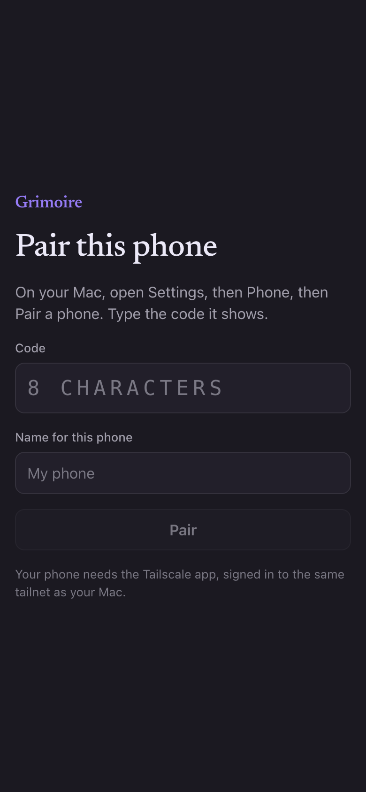
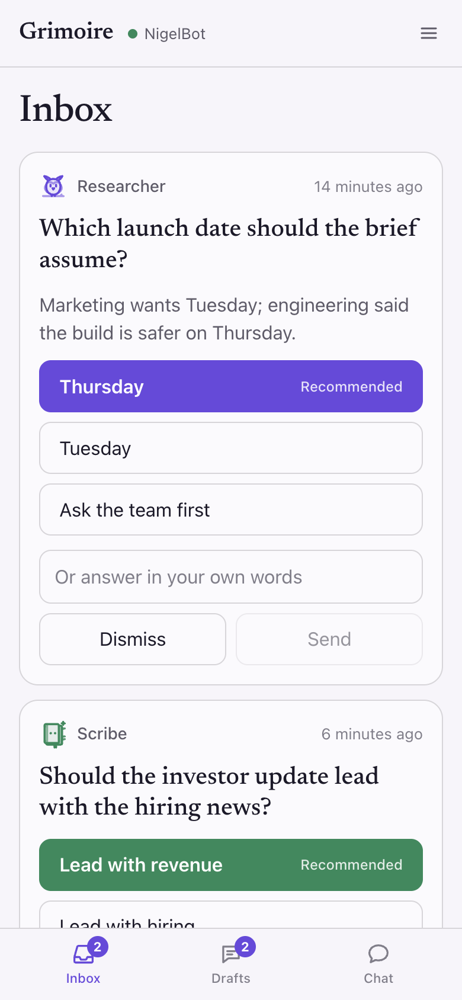
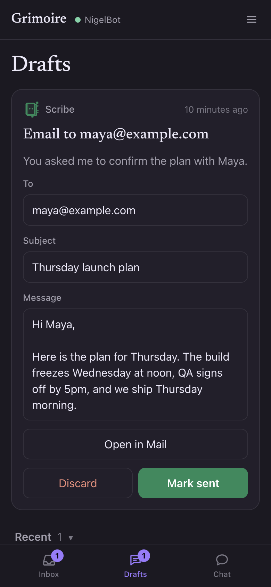
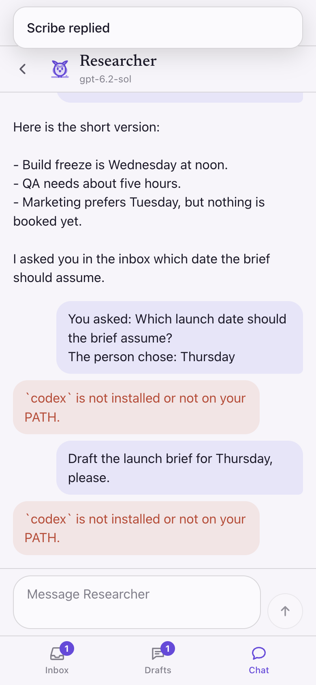

# Phone companion

Grimoire on your Mac serves a small web app to your phone over your Tailscale tailnet. From the
phone you can answer the decision inbox, review and send drafts, chat with a familiar, and see
alerts when something needs you. Familiars, tools, the vault, and settings stay on the Mac.

This is the MVP scope. The last section lists what it leaves out.

<table>
  <tr>
    <td width="25%"></td>
    <td width="25%"></td>
    <td width="25%"></td>
    <td width="25%"></td>
  </tr>
</table>

## Platform: a web app the Mac serves

The phone app is a web page that Grimoire on the Mac serves itself, at
`http://<your Mac's Tailscale address>:47621`. Open it in Safari or Chrome and add it to the home
screen.

Why not Expo or React Native:

- Nothing to install, sign, or submit to a store. The phone and the Mac always run the same version,
  because the Mac serves the page.
- It reuses the desktop app's SolidJS, CSS tokens, and helpers (draft links, markdown).
- A native app earns its place later, mainly for push notifications that arrive while the app is
  closed. See "Later".

The page is a second Vite entry, `phone.html`, built into the same `dist/` the desktop app embeds.
The Mac serves it from Tauri's embedded assets, so nothing reads files from disk.

## Reaching the Mac: Tailscale, like linked Macs

Grimoire already links Macs over Tailscale (`link.rs`). The phone uses the same approach:

- The companion server listens on port 47621, only on the addresses Tailscale reports for this Mac.
  It never binds `0.0.0.0` or the LAN.
- It drops any connection whose source address Tailscale doesn't list as a peer or as this Mac.
  This is the same check linked Macs use, through the signed Tailscale CLI.
- WireGuard encrypts the traffic, so the protocol is plain HTTP/1.1 with JSON.
- Nothing listens until you pair a phone or start pairing. Remove the last phone and the port closes.

A relay was ruled out because Grimoire would have to run a server that sees every message. Port
forwarding was ruled out because it puts the Mac on the internet.

The phone needs the Tailscale app, signed in to the same tailnet.

## Pairing

1. On the Mac, open Settings, then Phone, then click Show a pairing code. Grimoire shows the address to open
   and an 8-character code. The code uses no 0, O, 1, or I.
2. On the phone, open the address and type the code and a name for the phone.
3. The Mac gives the phone a random token with 244 bits of entropy, and the phone keeps it in local storage.

The code works once, lasts 10 minutes, and dies after 5 wrong tries. Pairing attempts are capped at
20 a minute. These are the same limits linked Macs use.

## Auth

- Every API call carries `Authorization: Bearer <token>`. The server checks the token before it reads
  the body, and compares it against every phone's token in constant time.
- Tokens live in the macOS Keychain, one per phone, under `companion:<phone id>`. The phone list,
  with names and last-seen times, is a setting in Grimoire's database.
- Settings, then Phone, lists each phone. Remove revokes its token at once. A phone can also unpair
  itself.
- A bearer header rather than a cookie means another site can't make the browser send it, so there
  is no CSRF. Pairing requires a JSON body, which a browser won't send cross-site without asking
  first. The API refuses a Host header that isn't a Tailscale address, a `ts.net` name, or a short
  name, so a site that points its own domain at the Mac (DNS rebinding) gets nothing.
- Removing a phone also ends a long poll it has open.
- The server never trusts an id from the phone to choose who acts:
  - Chat only reaches a familiar that exists on this Mac. A malformed id, an unknown id, or a linked
    Mac's `peer:` id is refused.
  - Answering an inbox item sends only the item's id and the answer. The Mac looks up which familiar
    asked. The same goes for drafts.
  - Request bodies refuse unknown fields, so a phone can't add an `agentId`.
- From the phone, an approval can be answered with Allow once or Deny. Always allow is a lasting
  grant, so it stays on the Mac.

## What the phone does

- **Inbox.** Pending approvals first, since they time out in 2 minutes, then open questions. Tap an
  option or write your own answer. Questions can be dismissed.
- **Drafts.** Waiting drafts, then recent ones. Edit the recipients, subject, and body. For email,
  Open in Mail opens the phone's own Mail with your edits. Mark sent tells the familiar what went out.
  Discard tells it not to send.
- **Chat.** Pick a familiar, read the recent history, send a message, and watch the reply stream in.
- **Alerts.** While the page is open, a banner shows when a familiar asks something, writes a draft,
  or finishes a reply in a chat you aren't looking at. The tab title shows how many decisions wait.
  Where the browser allows notifications, which needs HTTPS, the page offers to turn them on.

## API

All paths are on port 47621. Responses are JSON. Errors are `{ "error": "..." }` with a 4xx status.

| Method and path | Body | Answer |
|---|---|---|
| `GET /` | | The phone app |
| `POST /api/pair` | `{ code, name }` | `{ token, deviceId, mac }` |
| `GET /api/hello` | | `{ mac, device, version }` |
| `POST /api/unpair` | | `{}` |
| `GET /api/inbox` | | `InboxItem[]` |
| `POST /api/inbox/answer` | `{ id, kind, answer }` | `{}` |
| `POST /api/inbox/dismiss` | `{ id }` | `{}` |
| `GET /api/drafts` | | `Draft[]` |
| `POST /api/drafts/:id/send` | `{ to, subject, body }` | `Draft` |
| `POST /api/drafts/:id/discard` | | `Draft` |
| `GET /api/familiars` | | `{ familiars: Familiar[], busy: string[] }` |
| `GET /api/familiars/:id/messages?before=&limit=` | | `Message[]`, oldest first |
| `POST /api/familiars/:id/messages` | `{ text }` | `Message` |
| `GET /api/events?after=&wait=` | | `{ seq, epoch, events, reset }` |

Inbox ids travel in the body, since approval ids come from the CLIs and may hold any character. `kind` is the item's kind, so a question's answer can never reach an approval. For an approval, `answer` is `once` or `deny`. `Familiar` is `{ id, name, provider, model, avatar }`.

`/api/events` is a long poll that waits up to 25 seconds. Call it first without `after` to get the
current `seq`, then pass the last `seq` you saw. Each event is `{ kind, payload }`:

- `message`: a chat message, new or updated.
- `delta`: `{ agentId, messageId, chunk }` while a reply streams.
- `status`: `{ agentId, busy }`. `busy: false` means the turn ended.
- `inbox`: the inbox changed, so reload it.
- `drafts`: the drafts changed, so reload them.
- `familiars`: the familiar list changed.
- `chat`: `{ agentId }`. The familiar switched chats on the Mac, so reload its conversation.

`reset: true` means the phone missed events, so it reloads everything.

## Later

- **Push notifications while the app is closed.** These need HTTPS and a push service. One path is
  HTTPS through `tailscale serve` with Tailscale's certificate, plus Web Push, which iOS supports for
  web apps on the home screen. The other is a native app with APNs through a small relay that carries
  only "something is waiting". Both are bigger than this MVP.
- **QR code pairing,** so the phone doesn't have to type the address.
- **Attachments, stopping a turn, chat history threads, and side conversations** from the phone.
- **Linked Macs' familiars** from the phone. For now the phone reaches only the familiars that live
  on the Mac it paired with.
